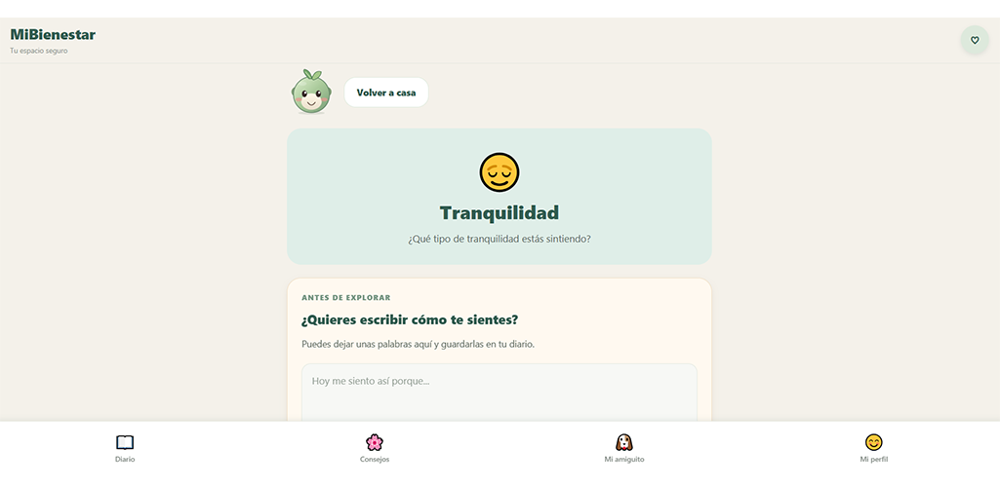
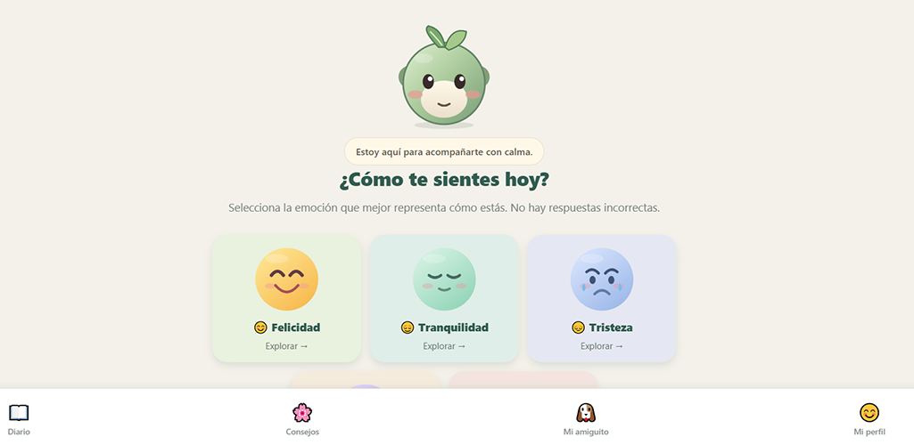
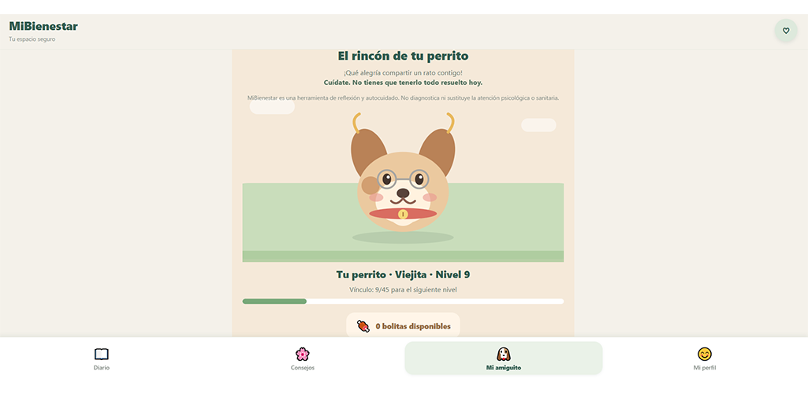
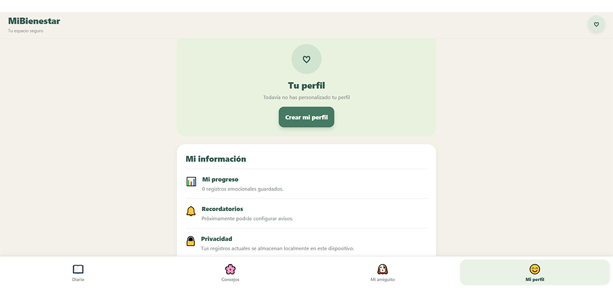

# 🌿 MiBienestar

Hello! I'd like to introduce you to **MiBienestar**, an Android application designed to help users improve their wellbeing by tracking their mood, building healthy habits and monitoring their personal progress.

## 📱 Download MiBienestar

**[⬇️ DOWNLOAD FOR ANDROID](https://github.com/AdrianRull/MiBienestar-app/releases/latest/download/application-00035461-eb20-4ef2-a23a-a856c9af01e5.apk)**

Click the link above to download the APK directly to your Android device. No need to navigate through the Releases section.

## ✨ Features

- Track your mood.
- Monitor your daily habits.
- Follow your personal progress.

## 🛠️ Technologies

- React Native
- Expo
- JavaScript

<h2>📸 Screenshots</h2>

  
  
  
  

<!-- Add your application screenshots here -->

## 🔗 Links

- [Download the latest version](https://github.com/AdrianRull/MiBienestar-app/releases/latest)
- [Privacy Policy](https://github.com/AdrianRull/MiBienestar-app/blob/main/index.html)

---

Developed by [AdrianRull](https://github.com/AdrianRull).
